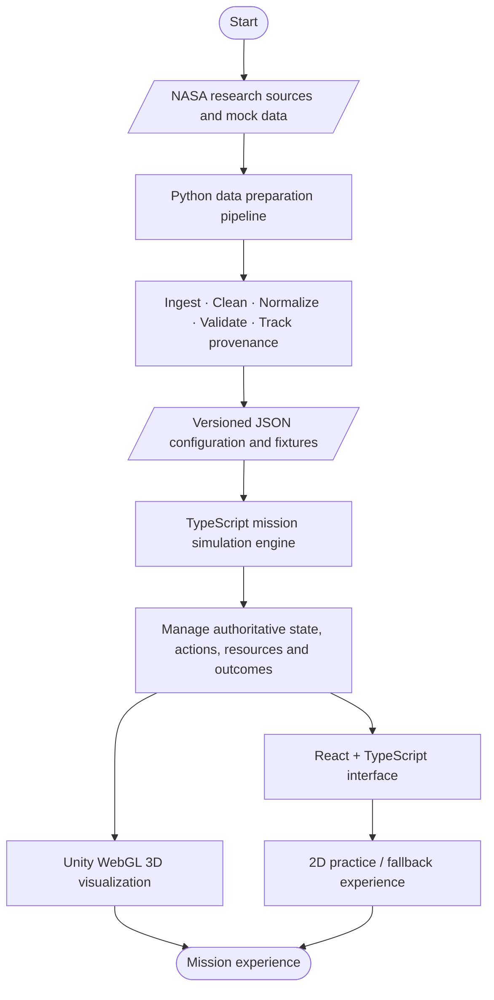

# LunaRangers

> **DARE TO DREAM. DEFY THE ODDS.**
>
> An interactive, science-informed lunar habitat engineering and survival simulation by **Neural Knights**, created for the NASA Space Apps Challenge 2026.

LunaRangers puts players in the role of a lunar mission crew member. Investigate equipment faults, evaluate evidence, make operational decisions, and experience the consequences for habitat systems and crew safety. The experience combines a Unity lunar environment with a React mission interface and a TypeScript simulation engine.

**Gameplay loop:** Mission → Investigate → Decide → Consequence → Learning.

- **Repository:** https://github.com/Ilmamasroor/lunaRanger
- **Live demo:** https://lunarangers-mission.vercel.app/
- **Demo recording:** https://lunarangers-mission.vercel.app/LunaRangers-Integrated-Demo.mp4
- **Challenge:** NASA Space Apps Challenge — Junior Astronaut Mission Trainer

> **Implementation note:** The repository contains a multi-day Unity campaign and a TypeScript simulation engine. Do not interpret every proposed science scenario, resource dependency, or cross-layer contract in the documentation as fully implemented or scientifically validated. See [implementation status](docs/implementation-status.md).

## Architecture

The flowchart below shows how research and prepared data feed the authoritative simulation engine, which drives the player interface and 3D experience. A 2D practice mode is available as a fallback.



- **Python** prepares and validates source data offline. It is not the live gameplay server.
- **TypeScript** is the sole authority for live simulation state, action validation, resource accounting and mission outcomes.
- **React + TypeScript** owns the player interface and renders engine results; it must not duplicate simulation calculations.
- **Unity WebGL** provides the 3D environment and visual interaction. It must not decide resource outcomes or mission success.
- **2D mode** provides an alternative practice experience when the WebGL experience is unavailable.

There is no Spring Boot runtime in the current MVP architecture.

## Repository layout

- `src/` — React application and TypeScript mission engine.
- `scripts/stage-unity.mjs` — stages a Unity WebGL export into `public/Build`, decoding Brotli-compressed assets when needed.
- `unity/` — Unity project and its usage/asset notes.
- `docs/` — architecture, contracts, science caveats and implementation status.

## Requirements

- Node.js compatible with the installed Vite 8 toolchain (use a current Node.js LTS release).
- npm.
- A modern browser with WebGL2 support for the 3D experience.
- Unity **6000.2.7f2** to open and rebuild the Unity project.

The repository's `package.json` defines the available npm scripts. The project does not currently define a `test` or `typecheck` script at the root.

## Run the React application

```bash
git clone https://github.com/Ilmamasroor/lunaRanger.git
cd lunaRanger
npm ci
npm run dev
```

Open the local URL printed by Vite.

## Build

```bash
npm run build
```

Optional lint command:

```bash
npm run lint
```

## Stage the Unity WebGL build

Export the Unity project for WebGL from Unity Editor **6000.2.7f2**, then run:

```bash
node scripts/stage-unity.mjs /path/to/your/unity-webgl-export
npm run build
```

The export directory is expected to contain a `Build/` folder with the LunaRangers loader, data, framework and WASM files (or Brotli-compressed versions for the non-loader assets). Generated files are placed in `public/Build/`, which is ignored by Git. Serve the production build over HTTP and configure the server to return `application/wasm` for `.wasm` files.

See [Unity setup](unity/README.md) and [integration contract](docs/react-unity-integration.md).

## Simulation engine

The TypeScript engine is the authoritative runtime for mission actions and resource state. Its package-level documentation and commands are located with the engine source. The root package scripts currently expose `dev`, `build`, `lint` and `preview`; run engine-specific checks from the engine package directory where its own package manifest defines them.

## Science and data integrity

LunaRangers distinguishes:
- **Research data** — values traceable to a cited source.
- **Engineering inference** — calculations or interpretations derived from evidence.
- **Gameplay assumptions** — values selected to make a playable scenario.
- **TBD / pending review** — unresolved inputs that must not be silently replaced with invented values.

A structurally valid mock configuration is not scientific validation. Several power, water, radiation, crop and resource-dependency decisions remain open. See [science and scenario notes](docs/science-and-scenarios.md) and [data contract](docs/python-typescript-data-contract.md).

## Research references

- [NASA CCMC DONKI](https://ccmc.gsfc.nasa.gov/tools/DONKI/) — space-weather event reference used in the Day 5 briefing.
- [NASA RadLab data API](https://visualization.osdr.nasa.gov/radlab/gui/data-api/) — radiation measurement reference described in the integration notes.
- [NASA OSDR study OSD-269](https://osdr.nasa.gov/bio/repo/data/studies/OSD-269) — ISS lettuce study used as nutrition learning context.
- [NASA 3D Resources](https://science.nasa.gov/3d-resources/astronaut/) — astronaut model attribution; see [Unity asset credits](unity/README.md).

These references support learning context; they do not by themselves validate the game's operational thresholds or gameplay coefficients.

## Team

**Neural Knights** — NASA Space Apps Challenge 2026. Contributions are made across product direction, simulation and data, frontend, Unity environment and research. See the repository history for individual contributions.

## Contributing

Please do not push directly to `main`. Work on a feature branch and open a pull request for review:

1. Create a branch from the current `main`.
2. Make focused changes and run the relevant checks.
3. Open a PR describing the change, evidence, tests and any known limitations.
4. Wait for review before merging.

## Licence

This repository is distributed under the **Apache License 2.0**. See [LICENSE](LICENSE).
