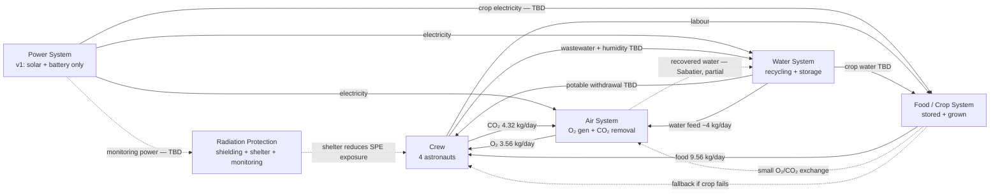

# Resource Dependency Matrix

**Project:** Junior Astronaut Mission Trainer — Lunar Survival Simulation
**Team:** Neural Knights
**Owner:** Fatima Khan
**Date:** 8 November 2026
**Companion files:** `simulation-parameter-sheet.md` · `food-system-research.md` · `emergency-scenarios.md`

---

## 1. Purpose

This matrix maps how the habitat's six systems affect one another. The development team uses it to:

- See which systems a failure in one system will cascade into.
- Decide which dependencies to model in v1 and which to simplify or omit.
- Identify the critical loops that drive gameplay tension.
- Design emergency scenarios (Part D) that stress specific edges in this matrix.

Two rules apply, mirroring the parameter sheet:

1. **No invented science.** Every value cited is traced to a source in Part A or Part B, or labelled as a derived calculation, or labelled as a gameplay assumption.
2. **"To be defined" is a valid answer** where the dependency exists but its magnitude is not yet known.

---

## 2. Systems in the Simulation

| # | System | Primary role | Parameters (see `simulation-parameter-sheet.md`) |
|---|---|---|---|
| 1 | **Crew** | Consumer of O₂, water, food; producer of CO₂, wastewater, body heat | §3.5 — crew size 4; mission duration 30 d reference |
| 2 | **Air** (O₂ generation + CO₂ removal) | Supply O₂ via electrolysis; remove CO₂; recover some water via Sabatier | §3.1 — O₂ 0.89 kg/p/d; CO₂ 1.08 kg/p/d; emergency O₂ reserve TBD |
| 3 | **Water** (recycling + storage) | Provide potable water; recover water from humidity + urine | §3.2 — 5.03 kg/p/d; humidity recovery ~99 %; urine recovery ~85 %; ISS overall milestone ~98 % |
| 4 | **Power** (v1: solar + battery only) | Supply electricity to all systems in v1. Fission is a proposed/future technology and is **out of scope for v1** (Part A §3.4). | §3.4 — solar TBD; battery TBD; ~14-day lunar night near equator (duration does not specify required storage) |
| 5 | **Radiation** (protection system: passive shielding + active shelter + monitoring) | Monitor radiation hazard; reduce crew exposure; shelter crew during SPE. *Note: this system represents the habitat's protection against the radiation hazard, not the radiation hazard itself.* | §3.3 — Chang'e-4 dose measurements; shelter factor TBD |
| 6 | **Food / Crops** (stored + grown) | Provide food mass + nutrients; supplement air exchange | §3.6 — 2.39 kg/p/d packaged; crop growth times; plant area 40–50 m²/p; Veggie chamber power TBD (cited NASA page does not state wattage); fertilizer 90 kg/p/yr |

**Important:** O₂ generation and CO₂ removal are **separate subsystems** within Air (research paper §2.1). The simulation must NOT couple them. Producing O₂ does not remove CO₂.

---

## 3. Dependency Matrix (2D table)

Read each cell as: *"Row system → Column system: what flows."*

| From ↓ \ To → | Crew | Air | Water | Power | Radiation | Food / Crops |
|---|---|---|---|---|---|---|
| **Crew** | — | produces CO₂ (4.32 kg/day) | urine water 5.60 kg/day + crew humidity 12.16 kg/day reference streams; treatment/recovery and store boundary defined in §12 | — | — | consumes food (9.56 kg/day) |
| **Air** | provides O₂ (3.56 kg/day) | — | recovers some water via Sabatier (partial) | — | — | — |
| **Water** | provides water (requirement reference: 20.12 kg/day; tank withdrawal TBD) | provides electrolysis feed (~4.0 kg/day stoichiometric min) | — | — | — | provides crop water (TBD) |
| **Power** | — | provides electricity (TBD kW) | provides electricity (TBD kW) | — | provides electricity (TBD kW) | provides electricity (illustrative 18–36 kW estimate; habitat power budget undefined) |
| **Radiation** | shelter reduces SPE exposure to crew | — | — | — | — | — |
| **Food / Crops** | provides food + nutrients | small O₂/CO₂ exchange (20–25 m²/p for air) | — | — | — | — |

**Legend:** Numbers with sources are research references or derived calculations. "TBD" means the dependency exists but its magnitude requires further research or a team decision (see §4).

---

## 4. Dependency Edges — Detailed

For every non-empty cell in §3: what flows · magnitude · source · what happens if the source side fails.

| # | Edge | What flows | Magnitude (per day unless noted) | Source / classification | If source side fails |
|---|---|---|---|---|---|
| 1 | Crew → Air | CO₂ production | 1.08 kg/person × 4 = **4.32 kg/day**; 30-day total **129.6 kg** | Research reference — NASA 2019 mass-balance (Part A §3.1) | If Air's CO₂ removal fails: CO₂ accumulates → air-quality emergency, **separate from O₂** |
| 2 | Air → Crew | O₂ supply | 0.89 kg/person × 4 = **3.56 kg/day**; 30-day total **106.8 kg** | Research reference — NASA 2019 mass-balance (Part A §3.1) | If Air's O₂ generation fails: emergency O₂ reserves (TBD) must cover the gap |
| 3 | Crew → Water | Urine, humidity, and feces water streams returned for processing | Reference streams for four crew: urine 5.60, humidity 12.16, feces 0.36 kg/day (Part C §12). Their processing and credit to storage depend on the selected system boundary. | Research reference — Ewert 2019, Figure 1; recovery and store debit require qualification | If Water recycling fails: stored reserves deplete; crew must reduce consumption |
| 4 | Water → Crew | Potable water | Tank withdrawal TBD; modelled daily water requirement is 5.03 kg/person × 4 = **20.12 kg/day** | Research reference for total requirement; tank withdrawal requires a defined boundary (Part A §3.2 and §12) | If reserves deplete: crew health emergency; electrolysis feed (edge 8) also affected |
| 5 | Power → Air (electrolysis) | Electricity for O₂ generation | TBD kW | Requires modelling decision (Part A §3.4 — habitat average power demand) | If power drops: O₂ generation drops; emergency O₂ reserves deplete |
| 6 | Power → Air (CO₂ removal) | Electricity for CO₂ scrubbers / fans | TBD kW | Requires modelling decision | If power drops: CO₂ accumulates even if O₂ generation is fine |
| 7 | Power → Water recycling | Electricity for pumps, filters, brine processor | TBD kW | Requires modelling decision | If power drops: water recovery drops; reserves deplete faster |
| 8 | Water → Air (electrolysis feed) | Water split into O₂ and H₂ | **~4.0 kg/day stoichiometric minimum** for 3.56 kg/day O₂ (2 H₂O → 2 H₂ + O₂; 36 kg water → 32 kg O₂); actual depends on system efficiency. **This is a daily flow rate drawn from the water store, NOT a storage threshold.** The store is debited for this flow but the water is consumed (does not return). See §12 Water Balance Accounting. | Derived calculation (stoichiometric); actual value TBD | If the water available for electrolysis falls below ~4.0 kg/day: O₂ generation must be reduced or stopped → cascades to edge 2 |
| 9 | Air (Sabatier) → Water | Recovered water from CO₂ + H₂ → CH₄ + H₂O | Partial recovery; percentage TBD (depends on system + available H₂) | Research reference — Ewert & Stromgren 2019, Figure 6; magnitude TBD | Without Sabatier: more make-up water needed; affects edge 4 sustainability |
| 10 | Power → Food / Crops | Electricity for lighting, pumps, climate control | Illustrative 18–36 kW estimate for a 180 m² setup; final value depends on crop mix + PPFD choice. Relative size within the habitat power budget is unknown. | Derived illustrative estimate — based on assumed crop area, PPFD, and lighting efficiency (Part B §5.4); not a NASA lunar specification. Final gameplay power requirement remains TBD until the dev team selects a value. | If power drops: crops slow or stop; growth cycle lost; fall back to stored food |
| 11 | Water → Food / Crops | Water for crop transpiration + nutrient solution | **Source-backed from Wheeler 2020 (NASA TM-2020-5008832, printed p. 9, Table 2):** lettuce ~2 L/m²/d; wheat ~5 L/m²/d; soybean ~5 L/m²/d. Potato TBD. Crop water use is gross BPC throughput; habitat store debit and recovered crop humidity remain TBD (see §12). | Research reference (Wheeler 2020 BPC) | If water shortage: crops fail; fall back to stored food |
| 12 | Food / Crops → Crew | Food mass + nutrients | 2.39 kg/person × 4 = **9.56 kg/day** packaged; 30-day total **286.8 kg**; grown supplement varies by mission length | Research reference — Ewert 2019 (Part A §3.6); grown split is a modelling decision | If crop failure: fall back to stored food; on long missions, vitamin B1 (~1 yr) / C (~3 yr) deficit risk |
| 13 | Food / Crops → Air | Small O₂ / CO₂ exchange via photosynthesis | 20–25 m²/person crop area provides air revitalization for one person (Wheeler); supplementary, **not primary** | Research reference — Wheeler (Part A §3.6) | Not relied on for primary air; crops can pause without immediate air emergency |
| 14 | Radiation Protection → Crew | Shelter reduces SPE exposure to crew | Factor TBD (% reduction in exposure) | Requires modelling decision (Part A §3.3). The radiation *hazard* comes from the SPE itself; the shelter is what the habitat provides to mitigate it. | Without shelter during SPE: crew radiation exposure rises; health risk |
| 15 | Crew → Food / Crops | Labour for planting, tending, harvesting | Crew time per day — TBD | Requires modelling decision | If crew shelters or is unavailable: crops untended; risk of crop failure (compounds edge 12) |
| 16 | Power → Radiation (monitoring) | Electricity for radiation monitors, alarms, sensors | TBD kW — exact draw not established | Gameplay assumption — real lunar habitats would have powered radiation monitoring; exact draw TBD | If power drops: radiation monitoring degrades; SPE detection may be delayed |

---

## 5. Visual Diagram

Dependency map. Solid arrows = primary resource flows. Dotted arrows = partial, supplementary, or event-driven flows.



---

## 6. Critical Failure Chains

These are the cascading failures the simulation must support. Each is from the research paper §7 or derived from the dependency edges in §4.

### 6.1 Power failure → life-support cascade

```
Power supply drops
  ↓
O₂ generation (electrolysis) slows or stops           — edge 5
CO₂ removal slows or stops                            — edge 6
Water recycling slows or stops                         — edge 7
  ↓
O₂ reserves begin depleting                            — edge 2
CO₂ begins accumulating                                — edge 1
Water reserves begin depleting                         — edge 4
Crop growth slows or stops (if power-hungry lighting)  — edge 10
  ↓
Stored O₂ and water become critical
Crew may need to pause non-essential activity
  ↓
Commander must: shed non-essential loads → restore power → wait for reserves to stabilise
```

**Key point:** A single power failure cascades into **three** life-support systems simultaneously. This makes power failure a high-priority scenario for the simulation to model — a gameplay/design judgement, not a quantitative ranking against other failure modes.

### 6.2 Water shortage → O₂ generation cascade

```
Usable water reserves drop (consumption > recovery)
  ↓
Crew reduces water consumption; recovery pushed harder
  ↓
If water drops further: electrolysis feed (edge 8) is throttled
  ↓
O₂ generation drops                                    — edge 2 affected
  ↓
O₂ reserves begin depleting
  ↓
Commander must: repair recycling, find make-up water, or use emergency O₂ reserves
```

**Key point:** Water and O₂ are coupled through electrolysis. A water shortage becomes an O₂ shortage.

### 6.3 CO₂ removal failure → air-quality emergency

```
CO₂ removal system stops (equipment fault or power loss to that subsystem)
  ↓
CO₂ begins accumulating at 4.32 kg/day                 — edge 1
  ↓
Cabin CO₂ concentration rises
  ↓
Air-quality emergency — even though O₂ supply (edge 2) is unaffected
  ↓
Commander must: repair CO₂ removal, use backup scrubbers, or reduce crew activity
```

**Key point:** This is an air emergency that O₂ generation cannot fix. The two subsystems are independent.

### 6.4 Crop failure → food-supplement cascade

```
Crop system fails (overwatering, fungus, power loss to lighting, contamination)
  ↓
In-progress crops are lost; growth cycle restarts from zero
  ↓
Grown-food contribution drops to zero                  — edge 12 partially lost
  ↓
Crew falls back to stored food only
  ↓
On long missions, relying exclusively on stored food may increase nutritional-deficiency risk as certain nutrients become inadequate in the stored-food menu
  — Vitamin B1 may be inadequate after ~1 year (Cooper 2017)
  — Vitamin C may be inadequate after ~3 years (Cooper 2017)
Restoring crop production may help, depending on crop selection and nutritional contribution
  ↓
Crew nutritional deficit worsens over time until crops are restored
```

**Key point:** Crop failure isn't catastrophic on a short mission, but on a long mission it compounds into a slow nutritional deficit.

---

## 7. Critical Loops (the gameplay tensions)

These are the tightly-coupled cycles the simulation should surface as player decisions.

### Loop A — Power ↔ Water ↔ O₂ (the central life-support triangle)

```
Power → electrolysis → O₂ → crew
Power → water recycling → water → electrolysis → O₂ → crew
Water → electrolysis → O₂ → crew
```

A power failure cascades into **both** water recycling and O₂ generation, **and** O₂ generation also depends on water. This is the densest coupling in the habitat and the source of the most severe cascading failures.

*Note: this is a dependency chain, not a self-sustaining feedback loop. Resources flow one direction (consumed by crew); the “loop” refers to the coupling that makes failures cascade, not to a closed cycle that sustains itself.*

### Loop B — Power ↔ Crops ↔ Food

```
Power → crop lighting (illustrative 18–36 kW estimate; habitat power budget undefined) → crops → food → crew
```

Crop lighting is a candidate load for the player to reduce or pause. Whether crop production is the most power-intensive subsystem is unknown until the complete habitat power budget is defined.

### Loop C — SPE ↔ Crew activity

```
SPE detected → crew shelters → pauses EVAs, crop tending, repairs
Shelter duration vs other activities = key decision
```

A solar particle event forces crew into shelter. While sheltered, they cannot tend crops (edge 15), perform EVAs, or do hands-on repairs. The crew must decide what to pause and for how long.

*Note: which activities pause vs continue automatically is a gameplay assumption. Life-support equipment (O₂ generation, CO₂ removal, water recycling, crop lighting) continues operating automatically while the crew shelters; only crew-labour activities (EVAs, manual crop tending, hands-on repairs) pause.*

### Loop D — CO₂ removal is independent of O₂ generation

```
(common pitfall: assuming O₂ generation handles CO₂)

O₂ generation: 2 H₂O → 2 H₂ + O₂      (consumes water + power, produces O₂)
CO₂ removal:    separate system          (consumes power, removes CO₂)
Sabatier:       CO₂ + 4 H₂ → CH₄ + 2 H₂O  (consumes H₂ + CO₂, recovers some water)
```

Both O₂ generation and CO₂ removal must work. A CO₂ removal failure is an air-quality emergency even if O₂ is fine. The simulation must model them separately.

---

## 8. v1 Modelling Priority

Not every dependency needs to be modelled in v1. Suggested priority:

| Priority | Edge(s) | Why |
|---|---|---|
| **Must model in v1** | 1, 2, 3, 4, 5, 6, 7, 12 | The core life-support loop (O₂, CO₂, water, food consumption) and the power feeds that drive them |
| **Should model in v1** | 8, 14 | Electrolysis-water feed (couples water shortage to O₂ shortage); SPE shelter decision |
| **Can simplify in v1** | 9, 10, 11, 13, 16 | Sabatier (gameplay-defined water recovery); crop power (single value only after a power-budget decision); crop water (potato value TBD — Wheeler 2020, printed p. 9, Table 2); crop air exchange (omit or fold into a flat bonus); radiation monitoring power (TBD or omit) |
| **Can omit in v1** | 15 | Crew labour for crops — only needed if crop failures are scripted or player-caused |

This priority list is a **gameplay modelling decision**, not a scientific finding. The dev team may adjust it.

---

## 9. Gameplay Implications

The matrix surfaces five decision types the player will face:

1. **Load-shedding under power shortage** — which systems get power, which get reduced or paused. Use the 3-tier priority scheme in Part A §3.4 (Critical / Important / Reducible).
2. **Repair triage** — when multiple systems fail, which to repair first. The central triangle (Loop A) drives the most urgent repairs.
3. **Resource reserve management** — how much O₂, water, and food to hold in reserve vs consume. Reserves are the buffer against cascading failures.
4. **Crop commitment** — planting a crop is a multi-week to multi-month commitment of power, water, and area. The 28–97 day range in Part B §6 combines different crops and experimental setups (microgreens 7–14 d; lettuce 28–33 d; dwarf wheat ~35–86 d; soybean 90–97 d), not a single universal growth duration. The player cannot easily back out once a crop is planted.
5. **Shelter timing** — during an SPE, when to shelter, how long to stay, and what to leave running untended.

Each of these maps directly to one or more emergency scenarios in `emergency-scenarios.md`.

---

## 10. Forward Reference to `emergency-scenarios.md`

Part D will stress-test specific edges and loops in this matrix:

| Scenario (proposed) | Edges stressed | Loop stressed |
|---|---|---|
| 1. Solar power generation decreases | 5, 6, 7, 10 (all power feeds) | Loop A (cascade) + Loop B (crop power) |
| 2. Water recycling equipment malfunctions | 3, 4, 7, 8 (water + electrolysis feed) | Loop A (water → O₂ cascade) |
| 3. Solar particle event triggers shelter decision | 14, 15, 16 (shelter + crew labour + radiation monitoring power) | Loop C (SPE pause) |

---

## 11. Open Questions

| # | Question | Owner |
|---|---|---|
| 1 | Pick TBD magnitudes for edges 5, 6, 7 (power per subsystem) | Dev team |
| 2 | Pick a value for edge 8 actual water-for-electrolysis (above the stoichiometric minimum) | Dev team |
| 3 | Pick a Sabatier recovery % for edge 9 | Dev team |
| 4 | Pick a crop-power value for edge 10 (illustrative range 18–36 kW) | Dev team |
| 5 | Retrieve the potato water-use value from Wheeler 2020 p. 9 Table 2 (lettuce/wheat/soybean already extracted — §4 edge 11; tomato is not in Table 2) | Research |
| 6 | Pick a shelter protection factor for edge 14 | Dev team |
| 7 | Pick a power draw for edge 16 (radiation monitoring) — TBD | Dev team |
| 8 | Decide whether crew labour (edge 15) is modelled in v1 | Dev team |
| 9 | Confirm v1 modelling priority in §8 | Dev team |

---

## 12. Water Balance Accounting

This section separates the modelled crew water requirement from individual return streams, electrolysis feed, crop-water throughput, and water returned to storage. **The 20.12 kg/day crew requirement is not treated as a confirmed potable-store withdrawal.**

### 12.1 System boundary

The water-store debit for crew use cannot be calculated from the 5.03 kg/person/day total alone. That total includes water on the supply side of the reference-astronaut mass balance, including water in food and metabolic water. The simulation must define which of these streams are supplied from the habitat's potable-water store before assigning a crew-store withdrawal. Until then, crew-store withdrawal is TBD.

### 12.2 Crew water reference streams (Ewert & Stromgren 2019)

The following are modelled reference-astronaut streams, not measured lunar-habitat flows:

| Stream (per astronaut) | Value | Unit | Source location |
|---|---:|---|---|
| Daily water requirement | 5.03 | kg/day | Ewert 2019, Figure 3 |
| Urine water | 1.40 | kg/day | Ewert 2019, Figure 1 |
| Perspiration + respiration water (humidity) | 3.04 | kg/day | Ewert 2019, Figure 1 |
| Feces water | 0.09 | kg/day | Ewert 2019, Figure 1 |

**For four crew (derived):** urine water = 5.60 kg/day; perspiration/respiration humidity = 12.16 kg/day; feces water = 0.36 kg/day; total daily water requirement = 20.12 kg/day. These values are distinct streams; do not calculate an “unrecovered crew water” residual by subtracting the three return streams from 5.03 kg/day because the source figures do not establish that as a compatible store-withdrawal balance.

### 12.3 Daily flow table

| # | Flow | Direction | Daily amount (4 crew) | Source → Destination | Accounting treatment |
|---|---|---|---|---|---|
| 1 | Crew water requirement | REFERENCE | **20.12 kg/day** | Reference balance → Crew | Requirement reference only; potable-store withdrawal TBD |
| 2 | Crew urine water | PROCESS | **5.60 kg/day** | Crew → Urine processor | Reference stream; recovery credited only after processing |
| 3 | Crew humidity water | PROCESS | **12.16 kg/day** | Crew → Humidity condensate system | Reference stream; recovery credited only after processing |
| 4 | Crew feces water | LOSS / PROCESS | **0.36 kg/day** | Crew → waste handling | Separate reference stream; treatment/recovery in v1 TBD |
| 5 | Crew-humidity water recovered | IN | Humidity input × **~99%** | Humidity processor → Store | Modelled reference recovery for crew humidity only; not automatically valid for crop humidity or lunar system |
| 6 | Urine water recovered | IN | Urine input × **~85%** | Urine processor → Store | Modelled reference recovery; not guaranteed lunar-system performance |
| 7 | Crew-humidity processing loss | LOSS | Humidity input × ~1% | Humidity processor → loss | Derived from the modelled crew-humidity recovery rate |
| 8 | Urine processing loss | LOSS | Urine input × ~15% | Urine processor → loss | Derived from the modelled urine recovery rate |
| 9 | Electrolysis feed | OUT | **~4.0 kg/day stoichiometric minimum** for 3.56 kg/day O₂ | Water store → Electrolysis | Separate consumptive withdrawal; actual feed depends on system efficiency |
| 10 | Sabatier recovered water | IN | **TBD** | Sabatier → Store | Depends on system design and available H₂; do not assume a fixed recovery percentage |
| 11 | Crop-water use | THROUGHPUT | Rate × crop area | Store / nutrient loop → Crops | Wheeler 2020 gross BPC water-use reference; habitat store debit and recirculation boundary must be defined |
| 12 | Crop transpiration | PROCESS | **TBD** | Crops → Humidity system | Return fraction and crop-humidity recovery are TBD; do not apply the crew-humidity 99% rate |
| 13 | Crop water incorporated into biomass / other losses | LOSS | **TBD** | Crops → biomass / losses | Crop-specific amount not established here |

**Source note:** Ewert & Stromgren 2019, Figure 1 provides urine, perspiration/respiration, and feces water streams. Figure 3 provides the 5.03 kg/person/day daily water requirement and 5.33 kg/person/day recycled water available. Page 6 provides the approximate 99% humidity and 85% urine recovery model figures. Figure 6 provides Sabatier water and water-to-oxygen-generation ranges. These are modelled reference-system values, not universal lunar-system performance values.

### 12.4 Accounting principle — electrolysis is a separate withdrawal

Do not count electrolysis feed as part of the crew-water requirement or subtract it twice. If the simulation uses one water store, debit electrolysis feed once as its own consumptive flow. Credit only water that is actually recovered and returned to that store. The 5.03 kg/person/day requirement must not also be debited as a second, separate store flow until its component supply streams and store boundary are defined.

The humidity recovery figure applies here only to the crew humidity reference stream. Crop transpiration enters the humidity system as a separate stream; its collection and recovery rate remain TBD.

### 12.5 Net store balance

A numerical net daily store change is **not calculated in this version**. The crew potable-store withdrawal, crop-water store debit/recirculation, crop-humidity recovery, Sabatier output, and treatment of feces/hygiene streams are not sufficiently defined. The earlier worked example and its −6.51 kg/day result are withdrawn because they combined incompatible boundaries and assumed crop-humidity recovery.

Once the boundary is defined, calculate:

`Net store change = confirmed recovered-water inflows − confirmed store withdrawals − confirmed losses`

Count each flow once; process streams are not additional store inflows or outflows unless they cross the defined store boundary.

### 12.6 Remaining TBDs

- Crew potable-store withdrawal and which components of the 5.03 kg/person/day requirement are supplied from the store.
- Treatment/recovery of feces water and any hygiene/wash-water stream included in the selected mission model.
- Sabatier recovered-water output.
- Crop transpiration return fraction and crop-derived humidity recovery rate.
- Crop-water recirculation and actual store debit in the selected habitat design.

### 12.7 Implication for Scenario 2

A recycling failure reduces the affected stream's recovered-water inflow. The resulting store depletion cannot be assigned a reliable kg/day value until the store boundary and remaining TBD flows above are defined. The electrolysis feed remains a separate flow-rate requirement: the theoretical minimum is approximately 4.0 kg/day for 3.56 kg/day O₂, before system losses.


## 13. Change Log

| Version | Date | Author | Notes |
|---|---|---|---|
| v1.3.2 | 2026-11-08 | Neural Knights | Verification pass against the cited NASA sources. (1) §2 — updated the Food/Crops system row: the cited NASA Veggie page (2014) does not state a wattage, so Veggie chamber power is now TBD (the ~70 W figure reported elsewhere requires a direct URL to be properly cited). (2) No new values, calculations, or sources were introduced. |
| v1.3.1 | 2026-11-08 | Neural Knights | Reworked §12 to separate requirement references from store withdrawals and to list urine, crew humidity, and feces streams with correct Ewert source locations; removed unsupported residual and net-depletion example; limited humidity recovery to the crew stream; corrected crop-power and crop-water wording. |
| v1.3 | 2026-11-05 | Neural Knights | Revised per follow-up engineering review: (1) §12 rewritten — extracted per-stream crew water data from Ewert 2019 Figure 2 (urine 1.40 kg/p/d; perspiration + respiration 3.04 kg/p/d), correcting the earlier claim that per-stream data was unavailable (it was excluded from the original research package, not from the NASA source); urine return and humidity return now tracked separately (flows 6–7); water entering processing, recovered, and lost tracked per stream (flows 8, 10–13); Sabatier input and output separated (flows 4–5); 14 distinct flows now tracked. (2) §2 — Power system updated to "v1: solar + battery only"; fission removed from the v1 system description. (3) §4 edge 10 — removed "largest single power draw" claim (unconfirmed; v1 power budget undefined). (4) §4 edge 16 — radiation-monitoring power changed from "minimal" to TBD. (5) Diagram — POWER node label updated; RAD edge label updated to "TBD". (6) §3.2 crop-lighting claim qualified. |
| v1.2 | 2026-11-05 | Neural Knights | Revised per engineering review: (1) added §12 Water Balance Accounting — defines system boundary, 5 separate daily flows (crew supply, electrolysis feed, crop water, recycling recovery, Sabatier), accounting principle showing electrolysis feed is not double-counted, and a worked example. Gross crew supply (20.12 kg/day) is now clearly separated from recoverable wastewater (TBD). (2) Edge 11 (crop water) now source-backed from Wheeler 2020: lettuce ~2 L/m²/d, wheat ~5 L/m²/d, soybean ~5 L/m²/d — the 200–1,000 kg/kg horticulture figure removed. (3) Open question #5 updated to reflect that lettuce/wheat/soybean are extracted; potato/tomato still needed. |
| v1.1 | 2026-11-05 | Neural Knights | Revised after team review: (1) separated water *supplied to crew* (20.12 kg/day, research reference) from wastewater *returned to recycling* (TBD) in §3 and edge 3 — previous wording conflated demand with recoverable wastewater; (2) clarified that the Radiation system represents the habitat's protection against the radiation hazard, not the hazard itself (§2, §3, edge 14); (3) added missing edge 16 (Power → Radiation monitoring) to §4 and the diagram; (4) corrected edge 10 classification from “Gameplay assumption” to “Derived illustrative estimate” to match Part B §5.4; (5) reworded §6.4 vitamin-deficiency explanation to match Cooper 2017 (nutritional inadequacy in stored-food menu over time, not crop-failure-accelerated degradation); (6) added Water→Food and Power→Radiation edges to the Mermaid diagram; (7) softened “most dangerous failure mode” to a gameplay judgement; (8) clarified Loop A is a dependency chain not a feedback loop, and Loop C shelter-pause is a gameplay assumption with automatic life-support continuation; (9) clarified crop commitment 28–97 day range combines different crops. Now 16 dependency edges. |
| v1.0 | 2026-11-05 | Neural Knights | Initial dependency matrix. 15 dependency edges mapped; 4 failure chains; 4 critical loops; 1 Mermaid diagram. Built on parameter values from `simulation-parameter-sheet.md` v1.1 and `food-system-research.md` v1.1. |
